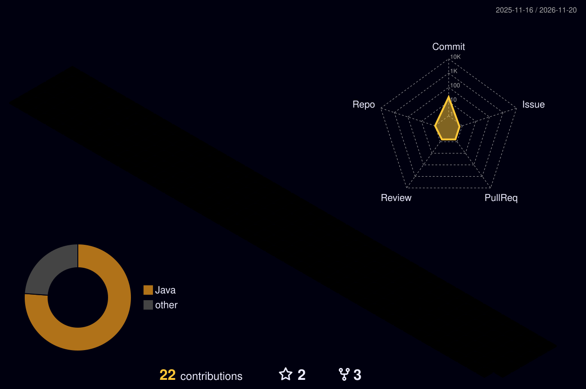

# Hey, I'm ulikw 👋

### Contributions

  

Developer · Learning, building, improving.

### About

I enjoy programming, exploring new technologies,
and building useful things.

### Tools & Technologies

  

### GitHub Activity

  
  

---

Always learning. Always building.
